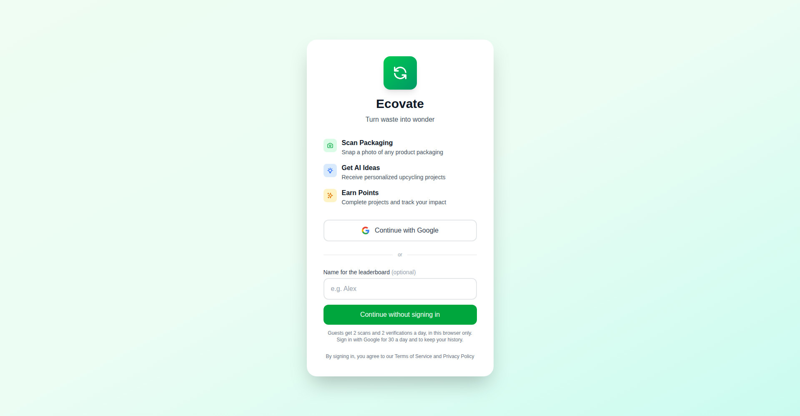
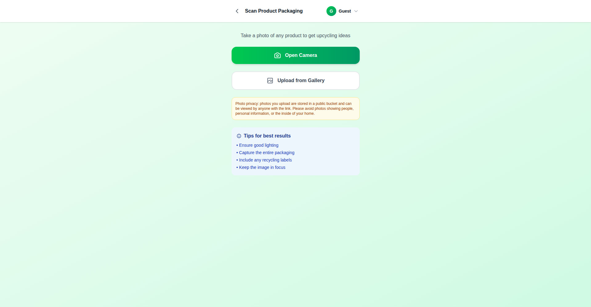
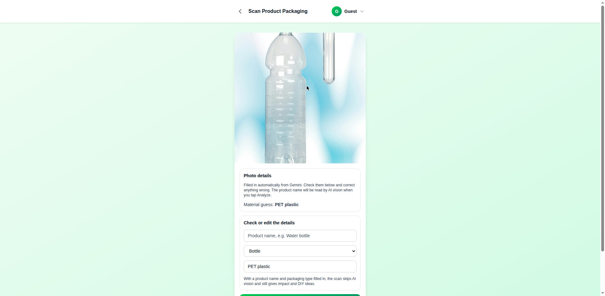
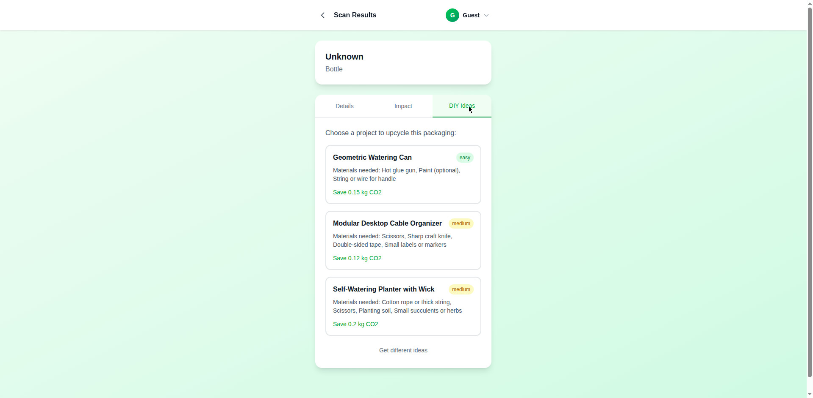
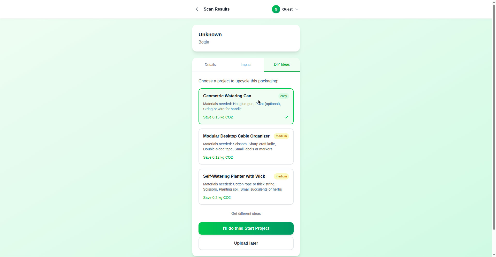
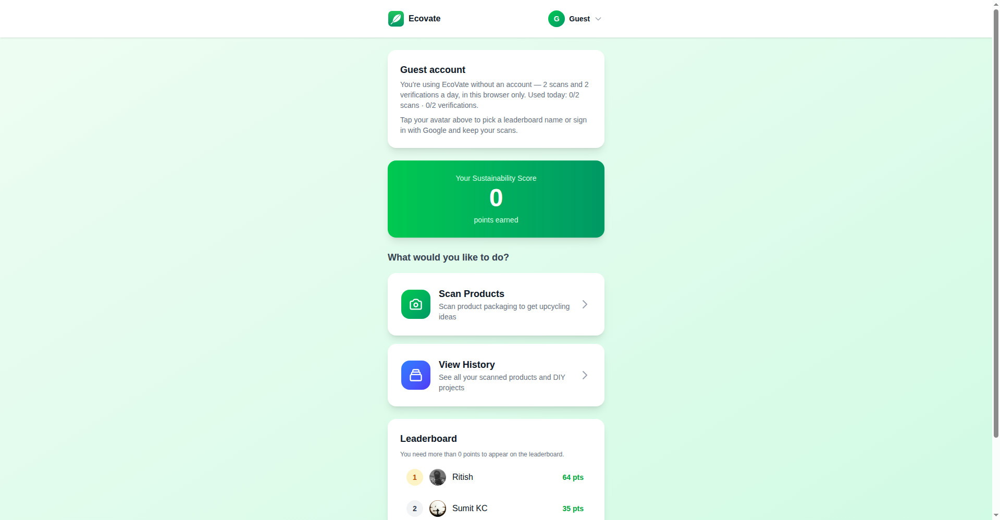

# EcoVate

AI-powered circular-economy platform that turns item photos into verified reuse and recycling plans through coordinated agents.

**Live demo:** https://ecovate-insforge-x-qoder-ai-agent-hackathon-sumit-70ea.vercel.app/

Built for the **Insforge x Qoder AI Agent Hackathon**, forked from [namumali/EcoVate-Insforge-x-Qoder-AI-Agent-Hackathon](https://github.com/namumali/EcoVate-Insforge-x-Qoder-AI-Agent-Hackathon).

## Team

- Namrata Mali
- Ayush Kumar Gupta
- Ritish Upadhyayula
- Sumit K C

## My Contribution

I implemented the multi-agent coordination workflow, connecting item scanning with vision analysis, sustainability research, DIY reuse recommendations, and verification so users receive practical and trustworthy actions for each item.

## Features

- **Photo scan** — take a photo or upload one from the gallery; no sign-in needed to try it as a guest.
- **Automatic analysis** — the photo is read in stages: on-device label text (OCR), on-device packaging shape, then AI vision. The vision model stays the authority when it is specific; the on-device checks fill in where it is vague.
- **Material, recyclability, and carbon** — each scan reports the detected materials, a recyclability score, and the estimated carbon footprint of the packaging.
- **DIY upcycling ideas** — every scan returns three reuse projects with a difficulty level, materials needed, step-by-step instructions, and estimated CO2 saved.
- **Verify and earn points** — pick a project, do it, and verify it with a photo. Verified projects earn points on the leaderboard.
- **Dashboard and history** — past scans, impact totals, and the leaderboard, with custom display names and avatars.
- **Guest or Google sign-in** — use it as a guest, or sign in with Google to keep history across devices. A guest account is deleted when it signs out, and inactive guests are swept after 7 days.

## How it works

1. A photo is uploaded from the scan page.
2. A pre-check runs on the device: label text is read with OCR, and the packaging shape is detected.
3. AI vision identifies the product, materials, and packaging type — Gemini first, Groq as the fallback.
4. The results page shows the material breakdown, recyclability score, carbon footprint, and three DIY ideas.
5. The user picks a project, completes it, and verifies it with a photo to score points.

The agents live in `src/lib/agents`: the coordinator runs the scan, the vision agent reads the photo, the research agent looks up sustainability facts, and the DIY agent writes the reuse projects. If the AI services are unavailable, a scan is saved as pending instead of failing.

## Screenshots

Captured from the live demo.

**Welcome**



**Scan packaging**



**Analyzing your photo**



**Scan results**



**DIY project**



**Dashboard and leaderboard**



## Tech stack

- Next.js 16.2.1, React 19, TypeScript, Tailwind CSS 4
- Insforge (Postgres database, auth, and storage) as the backend
- Gemini API for vision, with Groq as the free-tier fallback
- Tesseract.js for on-device label reading, TensorFlow.js + COCO-SSD for on-device shape detection

## Getting started

### Prerequisites

- Node.js 20 or later
- npm
- An Insforge project, plus Gemini and Groq API keys (both have free tiers)

### Installation

Clone the repository and install the dependencies:

```bash
git clone https://github.com/Sumitkc74/EcoVate-Insforge-x-Qoder-AI-Agent-Hackathon.git
cd EcoVate-Insforge-x-Qoder-AI-Agent-Hackathon
npm install
```

Create a `.env.local` file in the project root:

```env
NEXT_PUBLIC_INSFORGE_URL=your_insforge_url
NEXT_PUBLIC_INSFORGE_ANON_KEY=your_insforge_anon_key
INSFORGE_SERVICE_KEY=your_insforge_service_key
GEMINI_API_KEY=your_gemini_api_key
GROQ_API_KEY=your_groq_api_key
# Optional: override the Groq vision model (default is qwen/qwen3.8-27b)
GROQ_VISION_MODEL=qwen/qwen3.8-27b
```

Keep `INSFORGE_SERVICE_KEY`, `GEMINI_API_KEY`, and `GROQ_API_KEY` server-side and do not expose or commit them.

### Run the development server

```bash
npm run dev
```

Open [http://localhost:3000](http://localhost:3000) in your browser.

### Other commands

Run the linter:

```bash
npm run lint
```

Build and run the production version:

```bash
npm run build
npm run start
```

## Usage and limits

- Guests: 2 scans per day. Signed-in users: 30 scans and verifications per day. Guests share a pool of 40 scans per day.
- Photo uploads: JPEG, PNG, or WebP, up to 5 MB.
- The leaderboard lists only scores above 0.
- The live demo runs on free tiers: the Insforge project pauses after a week of inactivity, and if the Gemini quota runs out, scans fall back to Groq.

## Project structure

```
src/
  app/            Pages and API routes
    api/          actions, anon-session, dashboard, diy-ideas, guest,
                  history, leaderboard, material-guess, migrate-guest,
                  profile, scan, verify
    scan/         Scan page
    results/      Scan results page
    verify/       Project verification page
    dashboard/    Dashboard and leaderboard
    history/      Scan history
    auth/         Auth callback
    login/        Sign-in page
  components/     LeafLogo, UserMenu
  lib/
    agents/       coordinator-agent, vision-agent, research-agent, diy-agent
    free-vision.ts, groq-vision.ts, vision-merge.ts, detail-check.ts
    insforge.ts, storage.ts
    auth.ts, server-auth.ts, client-auth.ts
    image-resize.ts, diy-continue.ts
```
